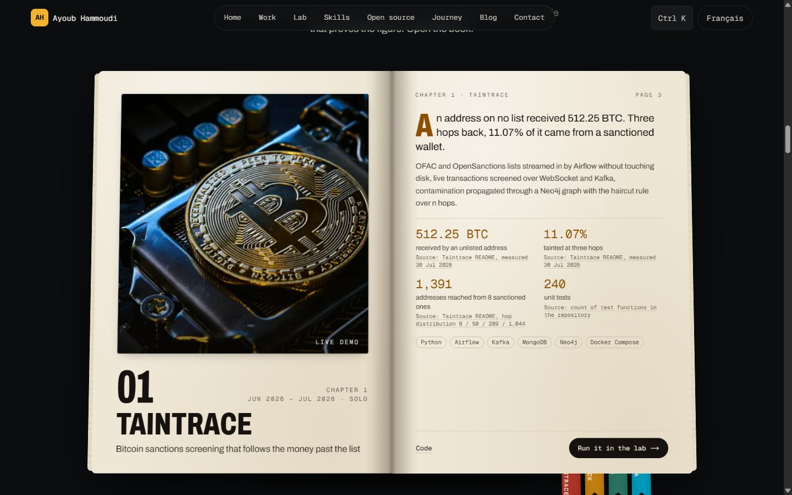
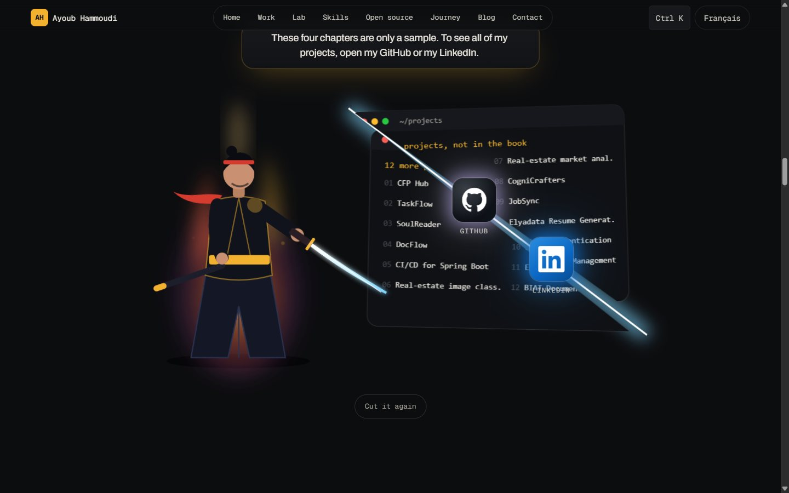
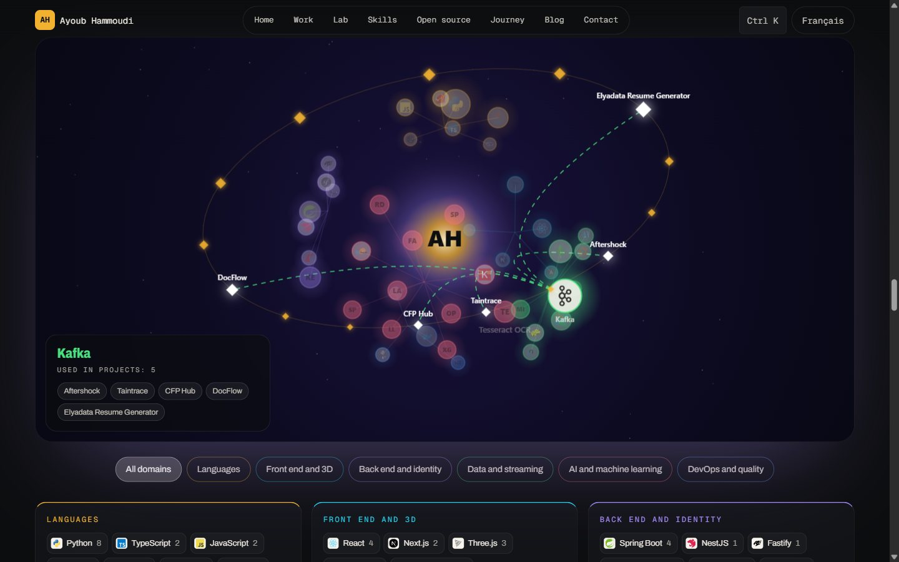
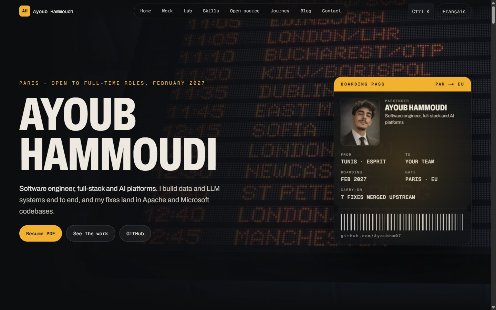

<p align="center">
  
</p>

<p align="center">
  <a href="https://github.com/Ayoubhm07/katana-forge/actions/workflows/ci.yml"></a>
  <a href="https://scorecard.dev/viewer/?uri=github.com/Ayoubhm07/katana-forge"></a>
  <a href="LICENSE"></a>
  
  
  
  
</p>

<h3 align="center">Stop shipping templates. Ship the frontend people screenshot.</h3>

<p align="center">
  <b>Katana Forge</b>, by <a href="https://ayoubhammoudi.com">Ayoub Hammoudi</a>, turns Claude Code into a squad of eight named specialists that design, choreograph, build,
  inspect and ship frontends people call a masterpiece, without giving up a single point of Lighthouse.
</p>

<p align="center">
  <a href="https://ayoubhammoudi.com"><b>See it live: ayoubhammoudi.com</b></a>
  &nbsp;·&nbsp; <a href="#quick-start">Quick start</a>
  &nbsp;·&nbsp; <a href="#the-team">The team</a>
  &nbsp;·&nbsp; <a href="#the-arsenal">The arsenal</a>
  &nbsp;·&nbsp; <a href="docs/fr/SKILL.md">Version française</a>
</p>

<p align="center">
  
  <br><sub>The opening of ayoubhammoudi.com, forged by this plugin. Pure SVG and CSS, played once per session, skipped for reduced motion.</sub>
</p>

---

## Why this exists

AI coding tools are great at producing *correct* interfaces. Correct is the problem: correct looks like
everyone else. Katana Forge encodes the opposite instinct, the one great creative studios have:

- **Every effect must mean something.** A book for projects that read like chapters. A swordsman who cuts a screen
  open to reveal where the rest of the work lives. A galaxy where every thread links a skill to the project that used it.
- **Truth is locked.** No invented figure, logo or quote. Every image has to *signify* its subject.
- **Beauty costs the user nothing.** Performance 95+, accessibility 100, readable without JavaScript, reduced motion honoured.

It was not designed in a vacuum. It was **forged in one night of sprints** on a real site, where a "beginner-level"
first draft became the piece below. Every rule in the plugin is a scar from that night.

## What it built

<table>
  <tr>
    <td width="50%"><br><b>A book that really opens.</b> Leather and gold foil, cream pages, leaves that follow your finger, ribbons to jump chapters.</td>
    <td width="50%"><br><b>A swordsman who cuts the screen.</b> He powers up, draws, dashes, and splits the list of other projects. GitHub and LinkedIn burst out of the cut.</td>
  </tr>
  <tr>
    <td width="50%"><br><b>A skill galaxy you jump into.</b> A sealed vortex, a hyperspace jump, then 43 skills in six constellations, each threaded to the projects that used it. No library.</td>
    <td width="50%"><br><b>A hero with a story.</b> A real departures board at night, a tilting 3D boarding pass, and a performance budget that never moved.</td>
  </tr>
</table>

## Quick start

**As a Claude Code plugin (recommended):**

```text
/plugin marketplace add Ayoubhm07/katana-forge
/plugin install katana-forge@katana-forge
```

**Or copy it into your user folder:**

```bash
git clone https://github.com/Ayoubhm07/katana-forge && cd katana-forge && ./install.sh
```

```powershell
git clone https://github.com/Ayoubhm07/katana-forge; cd katana-forge; ./install.ps1
```

**Then unleash it:**

```text
/forge Project: my portfolio. Code: ./site. Audience: Big Tech recruiters. Languages: en, fr.
```

Or in plain words: *"take this team front end and go wild"*. The Shogun takes it from there, wave by wave, and ends
with an honest verdict: **masterpiece** or **not yet**.

## The team

| | Agent | Craft |
|---|---|---|
| 将 | **Shogun** | Creative director. Finds the one metaphor, cuts everything without meaning, gives the final verdict. |
| 影 | **Kage**, the shadow | Scout. Harvests every real fact from code, GitHub, LinkedIn and resumes, each with its source. |
| 師 | **Sensei** | Experience architect. The visit, second by second, and a unique way into the flagship section. |
| 墨 | **Sumi**, the ink | Art director. Type, colour, SVG art, real photos and logos that mean something, credited. |
| 風 | **Kaze**, the wind | Choreographer. Splash, transitions, 3D, scroll-driven motion, physics, reduced motion. |
| 鉄 | **Tetsu**, the steel | Smith. Next.js, React, TypeScript, canvas engines, deferred loading, budgets. |
| 守 | **Mamori**, the guard | Guardian. Accessibility, no-JS, SEO and GEO, native-feeling mobile. |
| 検 | **Kensa**, the inspection | Adversarial critic. Freezes every animation frame by frame and hunts what breaks the magic. |

## The seven waves

`PLAN.md` ships a **ready-to-paste prompt for every agent at every wave**:

0. **Harvest**: the truth, with sources. 1. **Concept**: one metaphor, a storyboard, a visual system.
2. **Readable skeleton**: static, accessible, budgets in CI. 3. **Signatures**: the moments that make the piece.
4. **Richness**: real images and logos everywhere they mean something. 5. **Inspection**: frame by frame, phone, no-JS.
6. **Verdict and launch**: "Is it a masterpiece? Do the images make sense?" Then PR, merge, deploy, verify.

## The arsenal

Thirteen moves proven in production, each with its meaning, millisecond timeline, pitfalls and budgets, **described in words, never shipped as someone's source**:

| # | Move | Built with |
|---|---|---|
| 1 | "We enter his screen" opening | static SVG + CSS keyframes, injected only when it plays |
| 2 | Portal transition from the click point | View Transitions + `clip-path: circle()` |
| 3 | A 3D book that really opens | CSS 3D leaves, pointer drag, `inert` faces |
| 4 | A swordsman who cuts the screen | one SVG, clip-path halves, keyframed choreography |
| 5 | A skill galaxy with a hyperspace jump | canvas 2D, home-made projection, no library |
| 6 | Headings that decode themselves | rAF scramble, real text kept in the DOM |
| 7 | Rolling odometer readouts | per-character columns keyed on value |
| 8 | Logo marquees that ease to a stop | rAF track with eased speed |
| 9 | Pointer-lit cards | one delegated listener, CSS radial gradient |
| 10 | A timeline that draws itself | CSS scroll-driven animations, zero JS |
| 11 | Photo section covers that open on scroll | `animation-timeline: view()` |
| 12 | A tilting 3D boarding pass | CSS variables, glare |
| 13 | A lab console for live demos | ARIA tabs, mount on open |

Every move is meant to be **reinvented for your subject**, never copied: the book was right for projects; for a
restaurant it might be a menu that unfolds, for a bank a vault that opens.

## What is inside

```text
skills/katana-forge/
  SKILL.md              the oaths, the team, the run, connectors, the arsenal, the gates
  PLAN.md               7 waves, a ready-to-paste prompt per agent
  references/           signature moves, motion doctrine, performance lessons, masterpiece gate, connectors
  vendor/ui-ux-pro-max/ the MIT design database (67 styles, 161 palettes, 57 font pairings) with search scripts
agents/                 the 8 agents
commands/forge.md       /forge
examples/               the full case study of ayoubhammoudi.com
docs/fr/                the original French edition
```

## Lessons it already paid for

- Font CLS only appears on real networks. Measure production, not just CI on localhost.
- A heavy animation inside the React tree bloats the payload and hydration. Serve it as static SVG on demand.
- `<Suspense>` around each section splits hydration and brings TBT down.
- The first `requestAnimationFrame` timestamp can precede `performance.now()`. Clamp time at 0, or your canvas loop dies.
- One typo in an SVG logo path only shows to the eye. Always look at the render.

## Security, by design

A plugin that tells an AI how to build your product is a supply-chain component. It is treated like one:

- **`main` is protected**: it only moves through pull requests where every check of the **Forge Gate** is green.
- **Nine gates on every pull request**: plugin integrity, voice lock, SVG gate (no scripts, no external references),
  SHA-256 lock on vendored files, design database smoke test, Markdown lint, spelling,
  internal links, installers tested on Linux, macOS and Windows, ShellCheck, PSScriptAnalyzer, actionlint and
  zizmor on the workflows, and a Gitleaks secret scan of the full history.
- **Every GitHub Action is pinned to a full commit SHA**, runners are hardened, tokens are read-only by default
  and credentials are never persisted.
- **CodeQL, dependency review and OpenSSF Scorecard** run on every change.
- **Releases are signed**: each zip ships with a SHA-256 checksum and a build provenance attestation you can verify
  with `gh attestation verify katana-forge-vX.Y.Z.zip -R Ayoubhm07/katana-forge`.
- **Local gate before every push**: `git config core.hooksPath .githooks` runs the same checks on your machine.

See [SECURITY.md](SECURITY.md) to report a vulnerability privately.

## FAQ

**Is it only for Next.js?** No. The case study was built with Next.js and React, but the doctrine, the plan, the gates and
most moves are plain CSS, SVG and canvas. Tetsu adapts to your stack.

**Will it wreck my performance?** No. Budgets are an oath, not an option: the reference site holds Lighthouse
performance 0.95+ with a 3D book, a canvas galaxy and a cinematic opening.

**Can it make things up?** It is designed not to. Kage attaches a source to every fact, and the Shogun cannot pass
the gate with an unverified figure or a meaningless image.

## Author

**Katana Forge is created and maintained by [Ayoub Hammoudi](https://ayoubhammoudi.com).**
Software engineer in Paris, building data and AI platforms, with fixes merged into Apache and Microsoft codebases.
[Website](https://ayoubhammoudi.com) · [GitHub](https://github.com/Ayoubhm07) · [LinkedIn](https://www.linkedin.com/in/ayoubhammoudi)

Third-party pieces keep their own licences and credits: the bundled ui-ux-pro-max database (MIT, Next Level
Builder) and three moves inspired by 21st.dev community components (ideas only, no code shipped). See [NOTICE.md](NOTICE.md).

<p align="center"><sub>If the Forge helped you ship something people screenshot, a star helps others find it.</sub></p>
